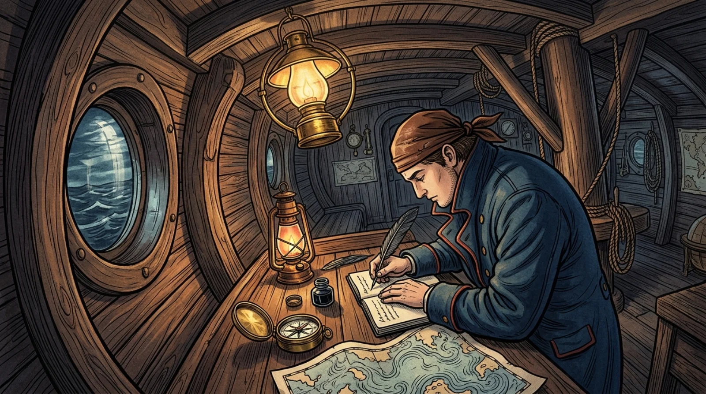

# 桑記 28巻10章「履歴の探訪者」
2026年10月

## 制作

**his** — ブラウザ履歴を集約・閲覧するローカルアプリ。[Website](https://noy4.github.io/his/)

## 視聴コンテンツ

  <a href="https://www.amazon.co.jp/dp/B009KWUID8" target="_blank" rel="noopener noreferrer">
    
    寄生獣（漫画）
  </a>
  <a href="https://www.netflix.com/title/81603806" target="_blank" rel="noopener noreferrer">
    
    ダウンタイム
  </a>

**寄生獣**（漫画／岩明均） — 90年代の名作を読了。
**ダウンタイム** — Netflixオリジナル（全8話）。美容整形業界のヒューマンサスペンス。

## 検索履歴
訪問サイト数：1101件（YouTube：126件）

10月はブラウザ履歴アーカイブ「his」を設計から公開まで一気に作り切った月。自作ツールをリリースしつつ、フロント／バックエンドとAIエージェントの最前線を横断的に調査。家の電気・水まわりを直しながら、建築と地理の教養をインプット。娯楽はONE OK ROCKの新曲、クレヨンしんちゃん、日向坂46、お笑い。アイスランド×日本のエネルギー比較サイトも制作した。

### 🧰 Web開発・自作ツール
自作ツールのリリースと、フロント／バックエンドの主要技術を横断的に検証。

  <a href="https://www.youtube.com/watch?v=RXhU9-oQCjY" target="_blank" rel="noopener noreferrer">
    
    10 Insanely Useful CLI Tools That Make Developers 10x More Productive - YouTube
  </a>
  <a href="https://www.youtube.com/watch?v=b4IlyJSIlL0" target="_blank" rel="noopener noreferrer">
    
    10 Backend Design Pattern Laws of Senior Engineers and Architects - YouTube
  </a>
  <a href="https://www.youtube.com/watch?v=KStTlCaeVIM" target="_blank" rel="noopener noreferrer">
    
    HTMX Will Finally Make Sense After This Video - YouTube
  </a>
  <a href="https://www.youtube.com/watch?v=tPQgw_DPIoM" target="_blank" rel="noopener noreferrer">
    
    Shadcn Just Fixed Tailwind's Biggest Problem - YouTube
  </a>
  <a href="https://www.youtube.com/watch?v=OsL9EJWz9UY" target="_blank" rel="noopener noreferrer">
    
    Effect 4.0 Just Got a Lot Harder to Ignore - YouTube
  </a>
  <a href="https://www.youtube.com/watch?v=J37YeB63LVI" target="_blank" rel="noopener noreferrer">
    
    Vite+ Just Killed Every Major Config Tool - YouTube
  </a>
  <a href="https://www.youtube.com/watch?v=l3L_lETiSzc" target="_blank" rel="noopener noreferrer">
    
    The runtime wars are over... and Node won - YouTube
  </a>
  <a href="https://www.youtube.com/watch?v=zv6B6PQOuHE" target="_blank" rel="noopener noreferrer">
    
    The last real programmers are dying out... - YouTube
  </a>
  <a href="https://www.youtube.com/watch?v=wajoP_5Cpw8" target="_blank" rel="noopener noreferrer">
    
    Every app on Earth is now open source... whether it likes it or not - YouTube
  </a>
  <a href="https://www.youtube.com/watch?v=S1em5t5msx0" target="_blank" rel="noopener noreferrer">
    
    StykAnimate Is Now Open Source - YouTube
  </a>
  <a href="https://www.youtube.com/watch?v=sNNYVooorvc" target="_blank" rel="noopener noreferrer">
    
    Why Pros See What You Can't - YouTube
  </a>

### 🤖 AIエージェント・モデル
AIエージェント基盤とモデルの勢力図を追跡。

  <a href="https://www.youtube.com/watch?v=iuBuavIinH8" target="_blank" rel="noopener noreferrer">
    
    OpenBot + Deepseek is the best Grok Bot & Muse Alternative! - YouTube
  </a>
  <a href="https://www.youtube.com/watch?v=BukNA_W1e3Y" target="_blank" rel="noopener noreferrer">
    
    Pi 2.0 (Codemode, Durable Tools & More!): Native via Codemode, Custom Model Routing & Pi Durable - YouTube
  </a>
  <a href="https://www.youtube.com/watch?v=0XQele28q0w" target="_blank" rel="noopener noreferrer">
    
    CLI-Anything: Turn ANY App into a CLI for Claude Code & Codex (GIMP, Blender, LibreOffice & More!) - YouTube
  </a>
  <a href="https://www.youtube.com/watch?v=G_em1hHPnXY" target="_blank" rel="noopener noreferrer">
    
    China just dropped a new frontier model... and nobody can explain how - YouTube
  </a>
  <a href="https://www.youtube.com/watch?v=b2tjnxX8IHU" target="_blank" rel="noopener noreferrer">
    
    Did Google just dethrone OpenAI and Anthropic? - YouTube
  </a>
  <a href="https://www.youtube.com/watch?v=nEaJMdM1djM" target="_blank" rel="noopener noreferrer">
    
    Did the AI bubble just pop? - YouTube
  </a>
  <a href="https://www.youtube.com/watch?v=SMGg7iisHmc" target="_blank" rel="noopener noreferrer">
    
    The most vulnerable week in internet history... - YouTube
  </a>
  <a href="https://www.youtube.com/watch?v=-Nvne3LzBls" target="_blank" rel="noopener noreferrer">
    
    Weekend Update: Anthropic CEO Dario Amodei on AI's Threat to Humanity - SNL - YouTube
  </a>
  <a href="https://www.youtube.com/watch?v=_M4FeYWkTuE" target="_blank" rel="noopener noreferrer">
    
    Weekend Update: Mr. Wonderful on Building an AI Data Center in Utah - SNL - YouTube
  </a>
  <a href="https://www.youtube.com/watch?v=azx8Up-cSWA" target="_blank" rel="noopener noreferrer">
    
    【dotsでAI秘書革命】ChatGPTの新機能！あらゆる業務を丸ごと任せる大AIエージェント時代の到来 - YouTube
  </a>
  <a href="https://www.youtube.com/watch?v=R-tLX37Xgx8" target="_blank" rel="noopener noreferrer">
    
    Why Rust Is The New GOAT For AI - YouTube
  </a>
  <a href="https://www.youtube.com/watch?v=lyGYidIZK4I" target="_blank" rel="noopener noreferrer">
    
    AI Just Made Physics Interactive. This Is Insane. (Anatomy) - YouTube
  </a>
  <a href="https://www.youtube.com/watch?v=FGXWGTMj7AY" target="_blank" rel="noopener noreferrer">
    
    Gen Z Has Found An Extremely Promising Solution - YouTube
  </a>

### 🏠 家・DIY・電気工事
電気工事と水まわり・建具の修繕を実践的に学習。

  <a href="https://www.youtube.com/watch?v=bDZlKxshsho" target="_blank" rel="noopener noreferrer">
    
    【DIY】3路スイッチ交換★階段照明スイッチ★ほたるランプが非常に便利★簡単HOWTO★WALL SWITCH - YouTube
  </a>
  <a href="https://www.youtube.com/watch?v=Ot7z97fpLA4" target="_blank" rel="noopener noreferrer">
    
    ３路スイッチ - YouTube
  </a>
  <a href="https://www.youtube.com/watch?v=DfOkl_lM9kw" target="_blank" rel="noopener noreferrer">
    
    浴室灯の交換、親爺のDIY! 3,550円で交換出来ました。 - YouTube
  </a>
  <a href="https://www.youtube.com/watch?v=io3TEUfMPTQ" target="_blank" rel="noopener noreferrer">
    
    DIY雨樋修理※丸どい　集水器の取り付け方 - YouTube
  </a>
  <a href="https://www.youtube.com/watch?v=gZbQDeuume8" target="_blank" rel="noopener noreferrer">
    
    雨どいのお手入れ方法【コメリHowtoなび】 - YouTube
  </a>
  <a href="https://www.youtube.com/watch?v=I4og5VbL7os" target="_blank" rel="noopener noreferrer">
    
    【大工女子のDIY】セルフリフォーム！マルノコで垂木をカットして雨樋を取付ける。 - YouTube
  </a>
  <a href="https://www.youtube.com/watch?v=WlAUbxBqTIk" target="_blank" rel="noopener noreferrer">
    
    【DIY】古い障子の隙間はこうやって直せ！！ひどいスキマを直す意外な方法。 - YouTube
  </a>
  <a href="https://www.youtube.com/watch?v=OIDeKtqM7VY" target="_blank" rel="noopener noreferrer">
    
    窓サッシの隙間テープの貼り方を独自に解説 - YouTube
  </a>
  <a href="https://www.youtube.com/watch?v=3H-mSyPDFpg" target="_blank" rel="noopener noreferrer">
    
    【やっと塞げた】こんだけ隙間空いてたら、そりゃ寒いわ！昔の土壁の欠点【大工の自宅リフォーム - part5】 - YouTube
  </a>
  <a href="https://www.youtube.com/watch?v=fyZqdO7XA6U" target="_blank" rel="noopener noreferrer">
    
    【必見】ネズミが出ない家にする対策&駆除ライフハック - YouTube
  </a>
  <a href="https://www.youtube.com/watch?v=Pgjosz-wtFE" target="_blank" rel="noopener noreferrer">
    
    【被害続出】ネズミ駆除プロフェッショナルに密着 顔めがけてダイブ!追い詰められ驚きの行動「ネズミ捕獲大作戦」『every.特集』 - YouTube
  </a>

### 🏗 建築・地理・教養
住宅建築と自然地理の基礎を体系的にインプット。

  <a href="https://www.youtube.com/watch?v=-LcYlA8RiDI" target="_blank" rel="noopener noreferrer">
    
    わずか15日間で完成する最安住宅。建設工程全体。 - YouTube
  </a>
  <a href="https://www.youtube.com/watch?v=4sRWTqm9lEE" target="_blank" rel="noopener noreferrer">
    
    最新技術で8日間で家を安く建てる | 最初から最後まで - YouTube
  </a>
  <a href="https://www.youtube.com/watch?v=bRtcFN0pHdw" target="_blank" rel="noopener noreferrer">
    
    【暴露】ドームハウスを建てて6年。もう限界なので全て正直に話します。施工不良と後悔の連続だった真実 - YouTube
  </a>
  <a href="https://www.youtube.com/watch?v=stVGZCxLvdc" target="_blank" rel="noopener noreferrer">
    
    「この世に直せない家はない」ボロボロの家を廃材で直す『異端の建築士』（2026年9月30日） - YouTube
  </a>
  <a href="https://www.youtube.com/watch?v=vlVVaZhRAEA" target="_blank" rel="noopener noreferrer">
    
    What is Physical Geography? Crash Course Geography #4 - YouTube
  </a>
  <a href="https://www.youtube.com/watch?v=ljjLV-5Sa98" target="_blank" rel="noopener noreferrer">
    
    How Does the Earth Move? Crash Course Geography #5 - YouTube
  </a>
  <a href="https://www.youtube.com/watch?v=11ZI9aqurfA" target="_blank" rel="noopener noreferrer">
    
    What Does the Atmosphere Do? Crash Course Geography #6 - YouTube
  </a>
  <a href="https://www.youtube.com/watch?v=OrhQmxK7s5A" target="_blank" rel="noopener noreferrer">
    
    How Does Air Temperature Shape a Place? Crash Course Geography #7 - YouTube
  </a>

### 🎸 音楽・ドラマ・お笑い・アイドル
新曲と定番の音楽、お笑い・アイドルをまとめて楽しんだ。

  <a href="https://www.youtube.com/watch?v=Qj38nD5tQAk" target="_blank" rel="noopener noreferrer">
    
    ONE OK ROCK - Jaded from "ONE OK ROCK AMBITIONS NORTH AMERICAN TOUR 2017" - YouTube
  </a>
  <a href="https://www.youtube.com/watch?v=UVRUC6Osxe0" target="_blank" rel="noopener noreferrer">
    
    PALEDUSK - LOSE YOURSELF (EMINEM COVER) + GOLDEN GOAL (LIVE AT THE PARISH, ANAHEIM, CA | 10/16/2026) - YouTube
  </a>
  <a href="https://www.youtube.com/watch?v=iCoxjS97mEg" target="_blank" rel="noopener noreferrer">
    
    【MV】仮面武闘会２/カルxピン Produced by チバニャン - YouTube
  </a>
  <a href="https://www.youtube.com/watch?v=6Px6lu8IBcM" target="_blank" rel="noopener noreferrer">
    
    Shabadaba - YouTube
  </a>
  <a href="https://www.youtube.com/watch?v=H8Kt925tvyw" target="_blank" rel="noopener noreferrer">
    
    'I' Novel - YouTube
  </a>
  <a href="https://www.youtube.com/watch?v=-rCYAeN7orA" target="_blank" rel="noopener noreferrer">
    
    One Man Live - YouTube
  </a>
  <a href="https://www.youtube.com/watch?v=ys3y_rjIbiI" target="_blank" rel="noopener noreferrer">
    
    Fever - YouTube
  </a>
  <a href="https://www.youtube.com/watch?v=hDylsRcPRok" target="_blank" rel="noopener noreferrer">
    
    【人気企画】大悟の教場！島田珠代の地獄指導で限界突破『チャンスの時間 #381』 - YouTube
  </a>
  <a href="https://www.youtube.com/watch?v=9u8G0DFm_cE" target="_blank" rel="noopener noreferrer">
    
    ジェラードン (キングオブコント2026) - YouTube
  </a>
  <a href="https://www.youtube.com/watch?v=4zdjrblUb9A" target="_blank" rel="noopener noreferrer">
    
    日向坂46・日向坂で会いましょう 2026年10月25日 FULL SHOW - YouTube
  </a>
  <a href="https://www.youtube.com/watch?v=v0NE0rO28kY" target="_blank" rel="noopener noreferrer">
    
    日向坂メンバーの名前を呼ぶオードリー若林 - YouTube
  </a>
  <a href="https://www.youtube.com/watch?v=TgyPk46sftM" target="_blank" rel="noopener noreferrer">
    
    バキ童chスタッフ間に亀裂…最近、馬肉かなめだけモテすぎている！ - YouTube
  </a>
  <a href="https://www.youtube.com/watch?v=7POQEgsXGBE" target="_blank" rel="noopener noreferrer">
    
    ロケマサから視聴者の皆様に大事な話があります - YouTube
  </a>
  <a href="https://www.youtube.com/watch?v=50eic9UjvvA" target="_blank" rel="noopener noreferrer">
    
    【爆買い】schottで革ジャンを買う。中田・品川・ジャンポケで男の憧れを見ようツアー【東京吉本】 - YouTube
  </a>
  <a href="https://www.youtube.com/watch?v=81f7GvymT78" target="_blank" rel="noopener noreferrer">
    
    『ピクチャログ －ESCAPE from 大喜利 LABYRINTH－』特報｜ Netflix Japan - YouTube
  </a>

### 💰 投資・時事・社会
資産形成の制度と、時事・社会の論点をインプット。

  <a href="https://www.youtube.com/watch?v=XzxcwxHSeno" target="_blank" rel="noopener noreferrer">
    
    【こどもNISAで学費準備】受付開始！長期投資で家計を守る新制度を徹底解説 - YouTube
  </a>
  <a href="https://www.youtube.com/watch?v=wbRaBUhkVhc" target="_blank" rel="noopener noreferrer">
    
    Using a TV Intro to Pick Stocks - YouTube
  </a>
  <a href="https://www.youtube.com/watch?v=uxSRs-dCEBA" target="_blank" rel="noopener noreferrer">
    
    中小企業社長だけど、息子よ、大企業に就職しろ - YouTube
  </a>
  <a href="https://www.youtube.com/watch?v=ZG1TBzKA3k0" target="_blank" rel="noopener noreferrer">
    
    二極化する教育と多様化社会―親が知っておくべき現実 - YouTube
  </a>
  <a href="https://www.youtube.com/watch?v=FEKzmYrCV8w" target="_blank" rel="noopener noreferrer">
    
    人はなぜ冷笑するのか【冷笑の文化史】 - YouTube
  </a>
  <a href="https://www.youtube.com/watch?v=jdhQuPOX53M" target="_blank" rel="noopener noreferrer">
    
    世界平和を実現する方法 - YouTube
  </a>
  <a href="https://www.youtube.com/watch?v=hmir93NorKo" target="_blank" rel="noopener noreferrer">
    
    【簗農水大臣辞任】辞任では終わらない！「予算と選挙」をめぐる公職選挙法違反疑惑 - YouTube
  </a>
  <a href="https://www.youtube.com/watch?v=3AZy6_GJ_8o" target="_blank" rel="noopener noreferrer">
    
    学校で習ったことって本当ですか？自分の手で証明しませんか？ - YouTube
  </a>
  <a href="https://www.youtube.com/watch?v=Xke84h-M84w" target="_blank" rel="noopener noreferrer">
    
    範囲が超狭いテストなら難問も解けるし高得点間違いなし！気持ちよくなっちゃおう！ - YouTube
  </a>
  <a href="https://www.youtube.com/watch?v=XD-kxW3TGLI" target="_blank" rel="noopener noreferrer">
    
    【千と千尋】｢この中に正解はいない｣って答えるの、実はマジで勇気いるんじゃね？？？ - YouTube
  </a>
  <a href="https://www.youtube.com/watch?v=wN46orVbGn8" target="_blank" rel="noopener noreferrer">
    
    The Psychology of Men Who Never Grow Up - YouTube
  </a>
  <a href="https://www.youtube.com/watch?v=3NGL3K6_iEk" target="_blank" rel="noopener noreferrer">
    
    The Psychology of People Who Want to Do Everything - YouTube
  </a>

### 🗾 地域・生活・雑学
地域の予定まわりと、ものづくり・雑学を拾い読み。

  <a href="https://www.youtube.com/watch?v=cPVhBmvg4Rk" target="_blank" rel="noopener noreferrer">
    
    【タイ王妃】自ら航空機を操縦し来日 戦闘機の操縦訓練も - YouTube
  </a>
  <a href="https://www.youtube.com/watch?v=LJ4N94Z5y8E" target="_blank" rel="noopener noreferrer">
    
    米テスラが「宙を舞うクルマ」を実演　空中旋回して着地、スペースＸと共同開発　2028年生産開始　最高時速は370キロ超 - YouTube
  </a>
  <a href="https://www.youtube.com/watch?v=h2nPmU4m6Ao" target="_blank" rel="noopener noreferrer">
    
    【人型ロボット"価格崩壊"の衝撃】変形ロボ／混雑した道も難なく走る無人タクシー／2年で7割安くなった正体 - YouTube
  </a>
  <a href="https://www.youtube.com/watch?v=H4MnuhERxsM" target="_blank" rel="noopener noreferrer">
    
    巨大あやとりで｢4段はしご｣を作って高いところに登ろう！ - YouTube
  </a>
  <a href="https://www.youtube.com/watch?v=_gg8n6un9tM" target="_blank" rel="noopener noreferrer">
    
    Can You Survive On a Deserted Island With Only Duct Tape? | MythBusters - YouTube
  </a>
  <a href="https://www.youtube.com/watch?v=Ugxwm0IC6l4" target="_blank" rel="noopener noreferrer">
    
    Why Did Humans Start Wearing CLOTHES ? - YouTube
  </a>
  <a href="https://www.youtube.com/watch?v=PvTyTUkuem8" target="_blank" rel="noopener noreferrer">
    
    I Built the WIDEST Street Legal Car - YouTube
  </a>
  <a href="https://www.youtube.com/watch?v=WO6aRHKe7_c" target="_blank" rel="noopener noreferrer">
    
    I Built the THINNEST Street Legal Car - YouTube
  </a>
  <a href="https://www.youtube.com/watch?v=VcOcP-c34eQ" target="_blank" rel="noopener noreferrer">
    
    メガネキャラで誰が最強か考えよう！【議論】 - YouTube
  </a>
  <a href="https://www.youtube.com/watch?v=bY_D5dMeRuo" target="_blank" rel="noopener noreferrer">
    
    スポーツの良さがわからないんだが！！！【提唱】 - YouTube
  </a>
  <a href="https://www.youtube.com/watch?v=Cg8Q0rRQM_g" target="_blank" rel="noopener noreferrer">
    
    コスプレってどうしたら良いの？コスプレ歴10年超の三橋くんが全て教えます！ - YouTube
  </a>
  <a href="https://www.youtube.com/watch?v=Jz0hPZ98Scc" target="_blank" rel="noopener noreferrer">
    
    【全部ドラフト】森羅万象から指名して理想の世界を作ろう！ - YouTube
  </a>
  <a href="https://www.youtube.com/watch?v=uTLEoyjHcog" target="_blank" rel="noopener noreferrer">
    
    世界のどこかに生まれるゲーム「80億分の1」、人生を考えさせられると話題にww - YouTube
  </a>
  <a href="https://www.youtube.com/watch?v=rq1RpFKmyRk" target="_blank" rel="noopener noreferrer">
    
    賞味期限切れはどちらだ！？分からなかったら捨てる権利無し！全部食え！！！ - YouTube
  </a>

## その他
- `kilo/deepseek/deepseek-v4.1-flash` で生成
- 表紙: `gemini-3.1-flash-image` で生成

